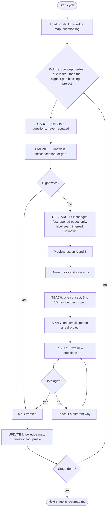
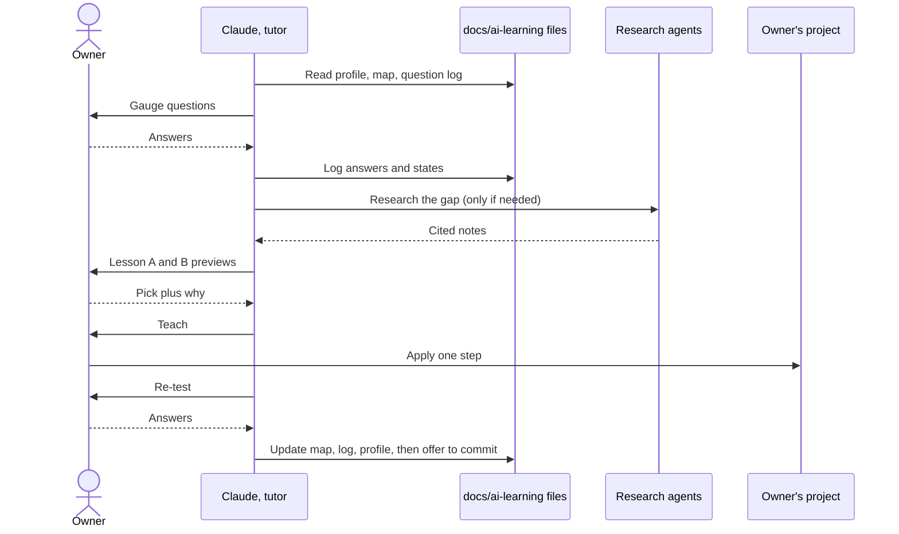
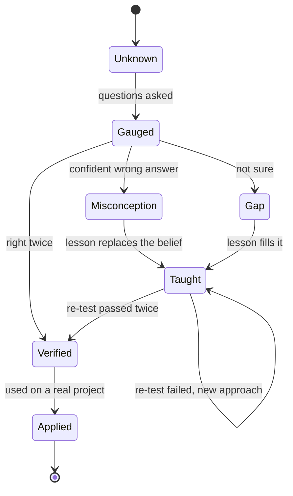

# The learning loop (approved 2026-10-14)

Run it with the `tutor-cycle` skill. Rendered version with notes: https://claude.ai/artifact/EQ7AZdQ7vGPZCqysc4xCw6

## Settings (the owner can change these)
- **Lesson A/B pick:** on. Before teaching, show two one-line previews of different teaching approaches. The owner picks and says why, and the pick goes into `profile.md`.
- **Lesson delivery:** in chat, 5 to 10 minutes. A page only if asked.
- **Mastery:** right twice in a row on differently worded questions.

## Activity diagram: one cycle

## Sequence diagram

## State machine: one concept

